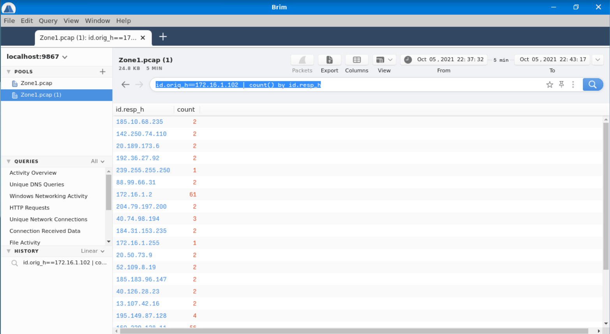
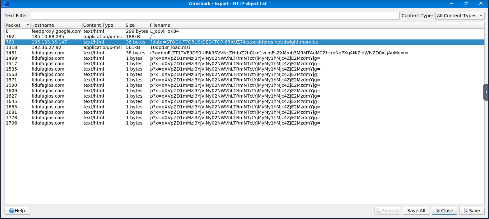
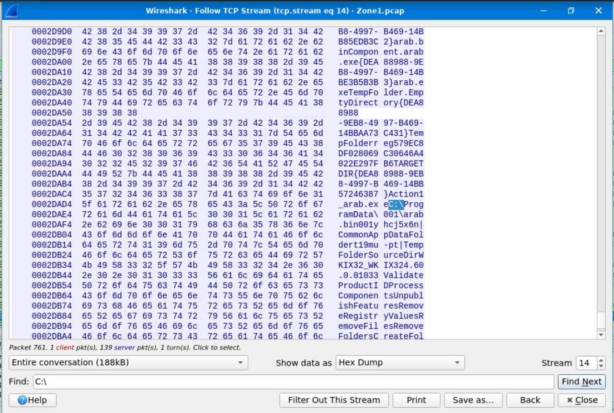
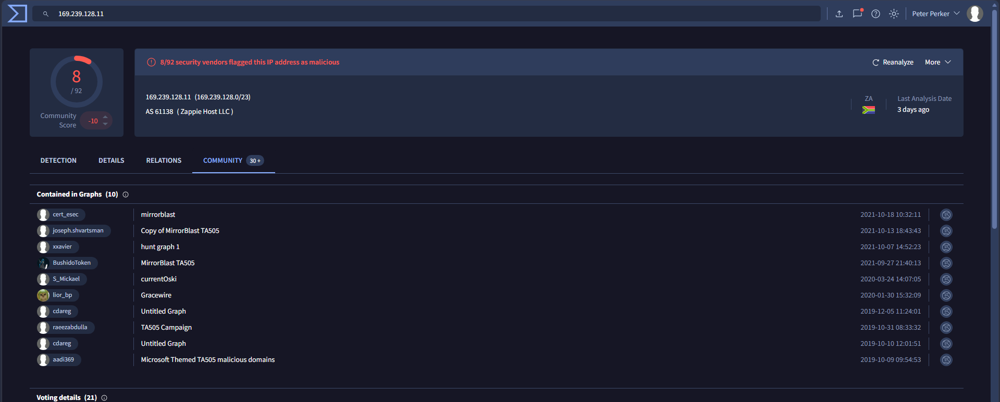

# Case 01: ET MALWARE MirrorBlast CnC Activity M3 (TA505)

- **Alert ID / Rule:** `ET MALWARE MirrorBlast CnC Activity M3`
- **Severity:** `Critical` | **Triage Verdict:** `True Positive`
- **Escalation Decision:** `Escalated to Tier 2 / Host Contained`
- **MITRE ATT&CK:** `T1566.001` (Spearphishing Attachment), `T1204.002` (Malicious File Execution), `T1059.007` (JavaScript/Scripting), `T1071.001` (Web Protocols - HTTP), `T1041` (Exfiltration Over C2)

---

## 1. Executive Summary (3 sentences max)
An IDS/IPS alert (`ET MALWARE MirrorBlast CnC Activity M3`) triggered on outbound command-and-control (C2) traffic initiated by internal workstation `DESKTOP-6RXUZ74` (`172[.]16[.]1[.]102`) to external infrastructure `169[.]239[.]128[.]11`. Deep packet inspection confirmed the host staged multiple malicious MSI packages (`filter.msi` and `10opd3r_load.msi`) across several external servers, dropping persistent executables into `C:\ProgramData` and exfiltrating Active Directory domain credentials for user `dwight.morales`. Tactical network isolation of the affected workstation was immediately executed, and all associated threat actor (TA505) indicators were defanged and forwarded for enterprise boundary blacklisting and Tier-2 incident response escalation.

---

## 2. Alert Scope
- **Affected Host / IP:** `DESKTOP-6RXUZ74` (`172[.]16[.]1[.]102`)
- **Domain Identity:** `stockitforus.net` (`STOCKITFORUS`)
- **Compromised Account:** `dwight.morales`
- **Primary C2 Server:** `169[.]239[.]128[.]11` (AS61138 - Zappie Host LLC)
- **External Payload Delivery & Staging Infrastructure:**
  - `185[.]10[.]68[.]235` (Hosted initial payload: `filter.msi`)
  - `185[.]183[.]96[.]147` (Received exfiltrated system reconnaissance string)
  - `192[.]36[.]27[.]92` (Hosted secondary payload: `10opd3r_load.msi`)
  - `195[.]149[.]87[.]128` (Hosting C2 beacon domain `fidufagios[.]com`)
- **Malicious C2 Domain:** `fidufagios[.]com`
- **Threat Actor Attribution:** `TA505` (Weaponizing `MirrorBlast` loader)

---

## 3. Investigation Timeline (UTC)

| Timestamp (UTC) | Log Source / Tool | Event / Finding |
| :--- | :--- | :--- |
| `2021-10-05 22:37:32` | Suricata / IDS | Initial alert fired: `ET MALWARE MirrorBlast CnC Activity M3` originating from internal host `172[.]16[.]1[.]102` connecting to `169[.]239[.]128[.]11`. |
| `2021-10-05 22:37:35` | Brim / Network Telemetry | Outbound connection profiling revealed `172[.]16[.]1[.]102` communicating with suspicious external endpoints including `185.10.68.235`, `192.36.27.92`, `185.183.96.147`, and `195.149.87.128`. |
| `2021-10-05 22:37:40` | Wireshark (Stream 14) | Host established HTTP connection to `185[.]10[.]68[.]235` and downloaded `filter.msi` (188 KB). MSI payload stream inspection revealed targets `C:\ProgramData\001\arab.bin` and `C:\ProgramData\001\arab.exe`. |
| `2021-10-05 22:37:41` | Wireshark (HTTP Packet 769) | Host initiated unencrypted HTTP GET request to `185[.]183[.]96[.]147` with reconnaissance query: `?data=STOCKITFORUS:DESKTOP-6RXUZ74.stockitforus.net:dwight.morales`. |
| `2021-10-05 22:37:45` | Wireshark (HTTP Packet 1318) | Host downloaded second MSI payload `10opd3r_load.msi` (561 KB) from `192[.]36[.]27[.]92`. Dissected artifacts indicate drops into `C:\ProgramData\Local\Google\rebol-view-278-3-1.exe` and `exemple.rb`. |
| `2021-10-05 22:38:00+` | Wireshark / Brim | Recurring HTTP beacons observed to `fidufagios[.]com` with User-Agent `REBOL View 2.7.8.3.1`, carrying base64-encoded system telemetry (`r?x=...` and `p?x=...`). |
| `2021-10-05 22:43:17` | Threat Intelligence (VT) | Threat intelligence enrichment correlated C2 node `169[.]239[.]128[.]11` and payload patterns to adversary group **TA505** and malware family **MirrorBlast**. |

---

### Forensic Evidence Artifacts

#### Evidence 1: Outbound Connection Aggregation (Brim)
Filtering by originating host (`id.orig_h==172.16.1.102 | count() by id.resp_h`) isolated outbound connections and highlighted the malicious IP clusters:

#### Evidence 2: Wireshark HTTP Object Export & Data Exfiltration
Extracting HTTP objects exposed the retrieval of MSI installers, active C2 beacons to `fidufagios[.]com`, and unencrypted reconnaissance exfiltration of the Active Directory domain, hostname, and user account (`dwight.morales`):

#### Evidence 3: TCP Stream Inspection of Dropped Files (Stream 14)
Deep inspection of the first MSI payload stream (`185.10.68.235`) revealed weaponized installation directories and dropped binary filenames on the local file system:

#### Evidence 4: Threat Intelligence & Adversary Attribution (VirusTotal)
Enrichment of destination IP `169.239.128.11` confirmed known malicious C2 activity with high-confidence community graphs linking directly to **TA505** and **MirrorBlast**:

---

## 4. What Could Make This Benign? (Disproving the Hypothesis)

Before finalizing an alert as a True Positive, alternative benign explanations were evaluated:

1. **Authorized Vulnerability Scan / Penetration Test:**
   - *Check:* Consulted change management board and security assessment schedules.
   - *Result:* No authorized red teaming, penetration testing, or scanner activity was scheduled for `stockitforus.net` during this timeframe.
2. **Legitimate Administrative Software Deployment:**
   - *Check:* Investigated whether `filter.msi` or `10opd3r_load.msi` were legitimate enterprise packages distributed via SCCM/MECM or Microsoft Intune.
   - *Result:* Packages originated from foreign VPS IP space (`Zappie Host LLC`, bulletproof hosting ranges), bypassed IT change control, and contained untrusted Rebol runtime binaries masquerading in `C:\ProgramData\Local\Google\`.
3. **Legitimate Developer / Administrative REBOL Usage:**
   - *Check:* Assessed whether `REBOL View 2.7.8.3.1` was an approved software tool for user `dwight.morales`.
   - *Result:* REBOL is not an authorized enterprise runtime in the corporate software repository. Its execution and direct communication with dynamic external hosts confirms evasive living-off-the-land/loader behavior.

**Conclusion:** All benign hypotheses are systematically disproven. The incident is classified as a confirmed **True Positive**.

---

## 5. Extracted IOCs (Defanged)

### Network Indicators
- **C2 IP Address:** `169[.]239[.]128[.]11` (AS61138)
- **Payload Delivery IP 1:** `185[.]10[.]68[.]235`
- **Payload Delivery IP 2:** `192[.]36[.]27[.]92`
- **Reconnaissance Exfiltration IP:** `185[.]183[.]96[.]147`
- **Beacon IP / C2 Host:** `195[.]149[.]87[.]128`
- **Malicious Domain:** `fidufagios[.]com`
- **User-Agent:** `REBOL View 2.7.8.3.1`

### Host & File Artifacts
- **Primary MSI Packages:**
  - `filter.msi` (Retrieved from `185[.]10[.]68[.]235`)
  - `10opd3r_load.msi` (Retrieved from `192[.]36[.]27[.]92`)
- **Dropped Files & Target File System Paths:**
  - `C:\ProgramData\001\arab.bin`
  - `C:\ProgramData\001\arab.exe`
  - `C:\ProgramData\Local\Google\rebol-view-278-3-1.exe`
  - `C:\ProgramData\Local\Google\exemple.rb`

---

## 6. Containment & Remediation Actions

### 1. Host-Level Actions (Immediate Tactical Containment)
- **EDR Host Isolation:** Issued immediate network containment on workstation `DESKTOP-6RXUZ74` via EDR to halt ongoing lateral movement and C2 beaconing.
- **Process Termination:** Terminated all active processes executing from `C:\ProgramData\001\` and `C:\ProgramData\Local\Google\`, specifically targeting `arab.exe` and `rebol-view-278-3-1.exe`.
- **File System Quarantine:** Quarantined dropped payload binaries (`arab.exe`, `arab.bin`, `rebol-view-278-3-1.exe`, `exemple.rb`) for dead-box forensic imaging and sandbox detonation.

### 2. Network-Level Actions (Perimeter Hardening)
- **Firewall & Proxy Blocks:** Implemented ingress and egress perimeter blocks on all identified external malicious IPs (`169.239.128.11`, `185.10.68.235`, `185.183.96.147`, `192.36.27.92`, `195.149.87.128`).
- **DNS Sinkholing:** Added `fidufagios[.]com` to internal DNS sinkhole and corporate web proxy blacklists.
- **IDS/IPS Rule Tuning:** Verified that Suricata rule `ET MALWARE MirrorBlast CnC Activity M3` is enforced in prevention (drop) mode across boundary sensors.

### 3. Identity-Level Actions
- **Credential Invalidation:** Reset Active Directory password and revoked all active Kerberos Ticket Granting Tickets (TGT) and active session tokens for user `dwight.morales`.
- **Audit Log Inspection:** Initiated a retrospective review of domain controller event logs (Event ID 4624/4625/4672) for `dwight.morales` to identify unauthorized authentication attempts.

### 4. Escalation & Tier-2 Handoff
- **Escalation Path:** Transferred complete case file, PCAP extracts, and isolated endpoint telemetry to Tier-2 Incident Response / Digital Forensics team.
- **Threat Hunting Scope:** Initiated an environment-wide hunt query across SIEM/EDR for occurrences of `rebol-view-*.exe`, writes to `C:\ProgramData\001\`, and outbound requests containing User-Agent `REBOL`.
