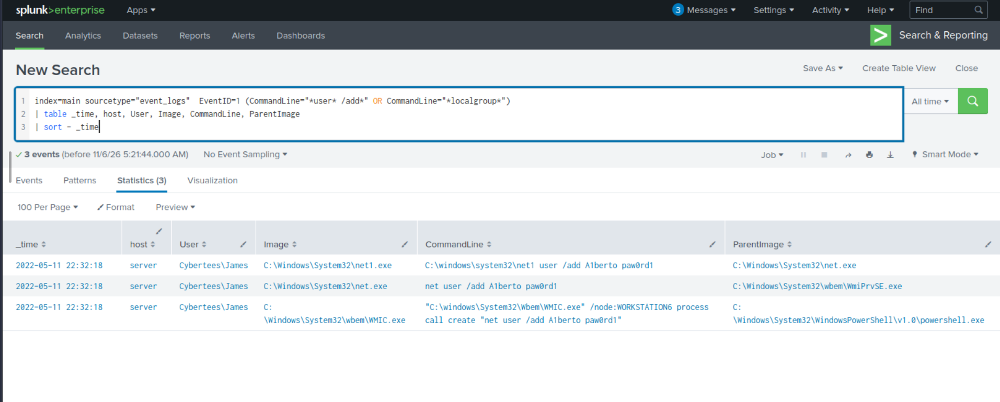
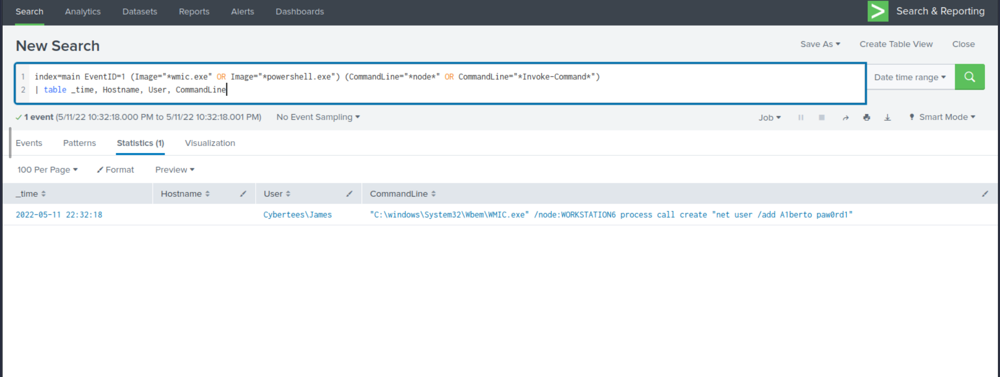
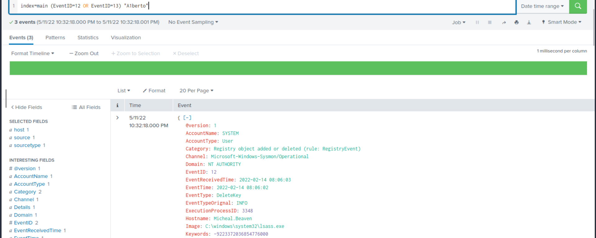
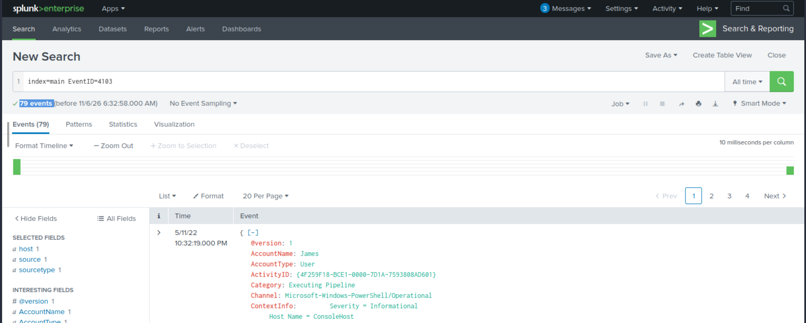
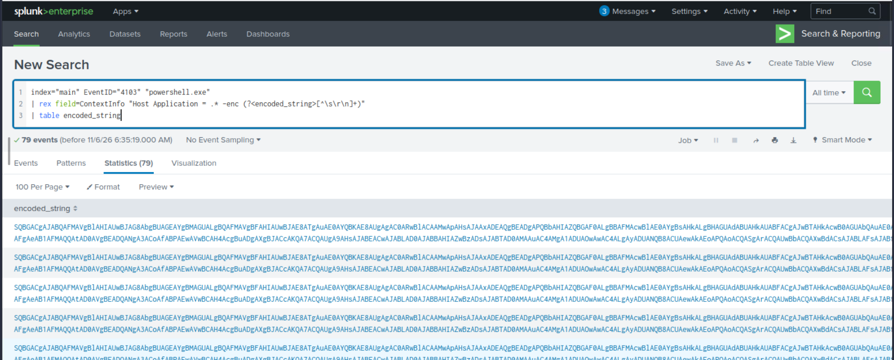
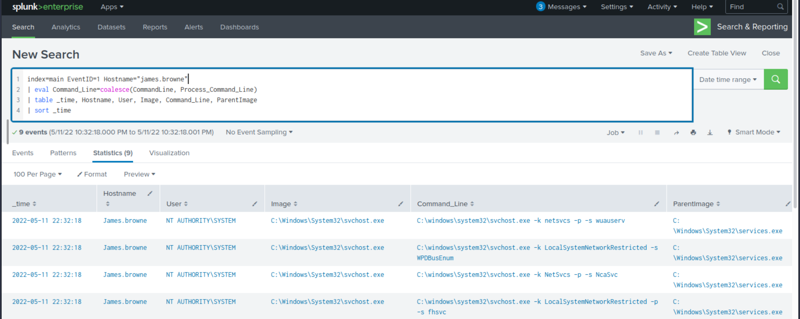
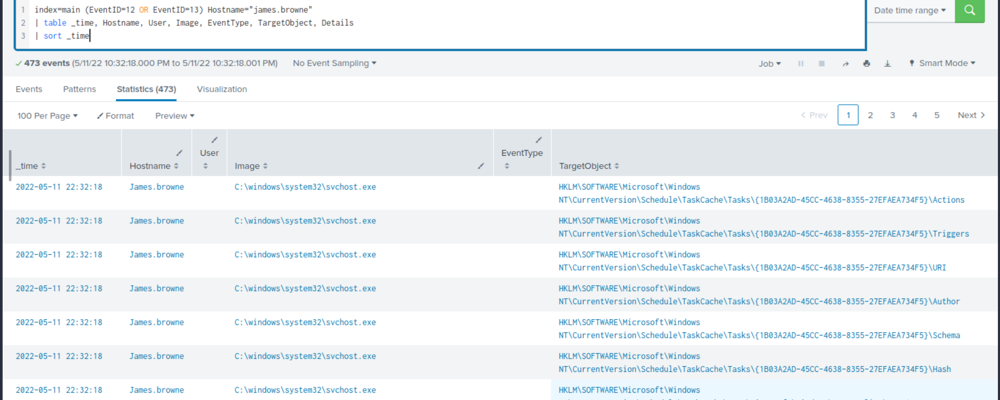

# Case 02: Unauthorized Persistence & Remote Execution via WMIC and Encoded PowerShell

- **Alert / Scope:** Splunk Enterprise SIEM Investigation (`investigatingwithsplunk`)
- **Severity:** `Critical` | **Triage Verdict:** `True Positive`
- **Escalation Decision:** `Escalated to Tier 2 / Host Isolation & Remediation`
- **MITRE ATT&CK:** `T1047` (Windows Management Instrumentation), `T1136.001` (Local Account Creation), `T1036.005` (Masquerading), `T1059.001` (PowerShell Execution), `T1027` (Obfuscated/Encoded Commands), `T1112` (Modify Registry), `T1071.001` (Web Protocols)

---

## 1. Executive Summary
During SIEM triage of Windows event logs and Sysmon telemetry in Splunk, an unauthorized lateral execution event was detected where compromised domain account `Cybertees\James` invoked Windows Management Instrumentation (`WMIC.exe /node:WORKSTATION6`) to remotely create a rogue local account (`A1berto`). Forensic inspection confirmed account persistence committed to the Security Account Manager (`HKLM\SAM\SAM\Domains\Account\Users\Names\A1berto`) via character-substitution masquerading (`l` replaced with `1` to mimic legitimate user `Alberto`), while compromised workstation `james.browne` recorded 79 obfuscated PowerShell pipeline executions (Event ID 4103) communicating with internal staging server `hxxp[://]10[.]10[.]10[.]5/news[.]php`. Immediate containment was executed by isolating the affected hosts, terminating active sessions, purging the backdoor account, and escalating the case to Tier-2 DFIR for enterprise-wide lateral movement scoping.

---

## 2. Alert Scope
- **Organization / Active Directory Domain:** `Cybertees` (`CYBERTEES`)
- **Compromised Domain Account:** `Cybertees\James`
- **Targeted Legitimate User Identity:** `Cybertees\Alberto` (Impersonated via typosquatting)
- **Created Rogue Identity:** `A1berto` (Local backdoor account)
- **Affected Hosts & Roles:**
  - `server`: Source host used to issue remote WMI process creation commands
  - `WORKSTATION6` / `Micheal.Beaven`: Target endpoint where the backdoor user was provisioned and SAM registry hive updated
  - `james.browne`: Host where 79 malicious obfuscated PowerShell commands were executed
- **Network / Staging Infrastructure:**
  - Internal Staging IP: `10[.]10[.]10[.]5`
  - Staging URL: `hxxp[://]10[.]10[.]10[.]5/news[.]php`

---

## 3. Investigation Timeline (UTC)

| Timestamp (UTC) | Log Source / Event ID | Telemetry / Event Details |
| :--- | :--- | :--- |
| `2022-05-11 22:32:18` | Sysmon Event ID 1 (Process Create) | `Cybertees\James` executed `WMIC.exe` from `server` targeting remote node `WORKSTATION6` to spawn `net user /add A1berto [REDACTED_PASSWORD]`. |
| `2022-05-11 22:32:18` | Sysmon Event ID 1 (Process Create) | Target host WMI provider (`WmiPrvSE.exe`) spawned `net.exe` and `net1.exe` locally to commit user creation. |
| `2022-05-11 22:32:18` | Sysmon Event ID 12 (Registry Event) | Target host (`Micheal.Beaven`) LSASS process created registry key `HKLM\SAM\SAM\Domains\Account\Users\Names\A1berto`. |
| `2022-05-11 22:32:18` | Security Event ID 4720 | Windows Security Audit logged the creation of local user account `A1berto`. Zero subsequent logon events (Event ID 4624) observed for this backdoor. |
| `2022-05-11 22:32:19` | PowerShell Event ID 4103 | Workstation `james.browne` logged 79 PowerShell pipeline executions running Base64-obfuscated commands under the `James` user context. |
| `2022-05-11 22:32:19` | PowerShell Script Analysis | Decoded script payload revealed an outbound HTTP request directed to `hxxp[://]10[.]10[.]10[.]5/news[.]php`. |

---

### Forensic Evidence Artifacts

#### Evidence 1: Detection of Remote Account Creation via Sysmon Process Creation
Querying Sysmon Event ID 1 for suspicious account provisioning commands identified the invocation of `net user /add` spawned through remote WMI execution:
```spl
index=main sourcetype="event_logs" EventID=1 (CommandLine="*user* /add*" OR CommandLine="*localgroup*")
| table _time, host, User, Image, CommandLine, ParentImage
| sort - _time
```


#### Evidence 2: Isolation of Remote WMIC Lateral Execution
Isolating administrative command interpreters confirmed that `Cybertees\James` invoked `WMIC.exe` targeting `/node:WORKSTATION6` via `process call create`:
```spl
index=main EventID=1 (Image="*wmic.exe" OR Image="*powershell.exe") (CommandLine="*node*" OR CommandLine="*Invoke-Command*")
| table _time, Hostname, User, CommandLine
```


#### Evidence 3: Verification of Registry SAM Hive Persistence
Investigating Sysmon registry events (Event ID 12/13) confirmed that the SAM database was modified to register the rogue `A1berto` account under the `Names` subkey:
```spl
index=main (EventID=12 OR EventID=13) "A1berto"
```


#### Evidence 4: High-Volume PowerShell Pipeline Execution Activity
Searching for PowerShell operational telemetry (Event ID 4103) identified a burst of 79 pipeline execution events initiated under the compromised account on `ConsoleHost`:
```spl
index=main EventID=4103
```


#### Evidence 5: Extraction and Decoding of Obfuscated PowerShell Payload
Using regular expressions in Splunk, the Base64-encoded command string passed to `powershell.exe -enc` was extracted:
```spl
index="main" EventID="4103" "powershell.exe"
| rex field=ContextInfo "Host Application = .* -enc (?<encoded_string>[^\s\r\n]+)"
| table encoded_string
```


##### Payload Dissection:
Decoding the UTF-16LE Base64 payload reveals the inner de-obfuscation logic:
```powershell
$ser=$([TeXT.ENCodiNG]::UnicodE.GetStriNG([CoNVeRT]::FroMBASe64StRInG('aAB0AHQAcAA6AC8ALwAxADAALgAxADAALgAxADAALgA1AA==')));$t='/news.php'
```
* **Inner Base64 String:** `aAB0AHQAcAA6AC8ALwAxADAALgAxADAALgAxADAALgA1AA==`
* **Decoded URL Target:** `http://10.10.10.5`
* **Full Requested Path:** `hxxp[://]10[.]10[.]10[.]5/news[.]php`

#### Evidence 6: Corroborating Endpoint Telemetry on `james.browne`
Correlating process creation events on host `james.browne` established the baseline system activities running in parallel with the PowerShell script executions:
```spl
index=main EventID=1 Hostname="james.browne"
| eval Command_Line=coalesce(CommandLine, Process_Command_Line)
| table _time, Hostname, User, Image, Command_Line, ParentImage
| sort _time
```


#### Evidence 7: Scheduled Task & Registry Auditing on `james.browne`
Auditing registry events for task cache modifications on `james.browne` to ensure no secondary persistence tasks were established:
```spl
index=main (EventID=12 OR EventID=13) Hostname="james.browne"
| table _time, Hostname, User, Image, EventType, TargetObject, Details
| sort _time
```


---

## 4. What Could Make This Benign? (Disproving the Hypothesis)

To validate the incident with forensic certainty, standard benign operational explanations were tested:

1. **Approved System Administration Scripting:**
   - *Hypothesis:* An authorized system administrator created a user account remotely via automated provisioning.
   - *Test:* Standard enterprise provisioning relies on Active Directory Domain Services (AD DS) tools (e.g., `New-ADUser`), Microsoft Endpoint Configuration Manager (MECM), or identity management workflows, not ad-hoc `WMIC.exe /node:...` calls with plaintext credentials.
2. **Legitimate User Onboarding for "Alberto":**
   - *Hypothesis:* Account creation was part of a regular employee onboarding request.
   - *Test:* The created account name is `A1berto` (with the digit `1` replacing lowercase `l`), whereas legitimate corporate directories identify user `Cybertees\Alberto`. No change ticket or ticketing record requested this spelling. This satisfies MITRE ATT&CK `T1036.005` (Masquerading: Match Legitimate Name).
3. **Routine Administrative PowerShell Scripting:**
   - *Hypothesis:* The PowerShell commands were standard monitoring scripts.
   - *Test:* Standard enterprise scripts do not utilize double-nested Base64-encoded strings (`-enc`) targeting unencrypted HTTP endpoints on non-standard internal addresses (`10.10.10.5/news.php`).

**Conclusion:** All alternative benign hypotheses are disproven. The event is a confirmed **True Positive** malicious intrusion.

---

## 5. Extracted IOCs (Defanged & Sanitized)

### Network Indicators
- **Internal C2 / Staging Node:** `10[.]10[.]10[.]5`
- **Malicious Staging URL:** `hxxp[://]10[.]10[.]10[.]5/news[.]php`

### Host & Identity Indicators
- **Compromised User Account:** `Cybertees\James`
- **Legitimate Impersonated Identity:** `Cybertees\Alberto`
- **Rogue Backdoor Account:** `A1berto`
- **Target SAM Registry Key:** `HKLM\SAM\SAM\Domains\Account\Users\Names\A1berto`
- **Observed Remote Execution String:**
  ```text
  "C:\windows\System32\Wbem\WMIC.exe" /node:WORKSTATION6 process call create "net user /add A1berto [REDACTED_PASSWORD]"
  ```
  *(Note: Original hardcoded password in script was `paw0rd1`, sanitized here in accordance with SOC reporting standards)*
- **PowerShell Obfuscation Artifact:** `powershell.exe -enc SQBGACgAWwBU...`

---

## 6. Containment & Remediation Actions

### 1. Host-Level Containment
- **Network Isolation:** Quarantined `WORKSTATION6` (`Micheal.Beaven`) and `james.browne` using EDR host isolation to prevent further lateral movement.
- **Account Remediation:** Deleted unauthorized local account `A1berto` via `net user A1berto /delete` and scrubbed residual registry entries from the SAM database.
- **Process Termination:** Terminated all active PowerShell (`powershell.exe`) and WMI-spawned child processes across affected endpoints.

### 2. Identity-Level Remediation
- **Credential Revocation:** Immediately disabled `Cybertees\James`, forced a domain password reset, and revoked all active Kerberos Ticket Granting Tickets (TGTs).
- **Domain Audit:** Reviewed authentication logs across all domain controllers for anomalous logon events involving `James`, `Alberto`, and `A1berto`.

### 3. Network Hardening & Detection Engineering
- **Internal Firewall Rules:** Blocked all internal network routing to `10[.]10[.]10[.]5` and sinkholed HTTP requests targeting `/news.php`.
- **WMI Hardening:** Restricted remote WMI access (`DCOM / WMI namespace security`) to approved tier-0 management subnets.
- **SIEM Detection Rules Implemented:**
  1. *Rule 1 (WMIC Remote Process Spawn):* Detect `wmic.exe` executed with `/node:` arguments spawning account modification tools (`net.exe`, `net1.exe`).
  2. *Rule 2 (Visual Impersonation in Account Creation):* Alert on Event ID 4720 where the account name exhibits high Levenshtein similarity to existing domain users.
  3. *Rule 3 (Encoded PowerShell Commands):* Alert on `powershell.exe` command-line strings containing `-enc` or `-encodedcommand`.
