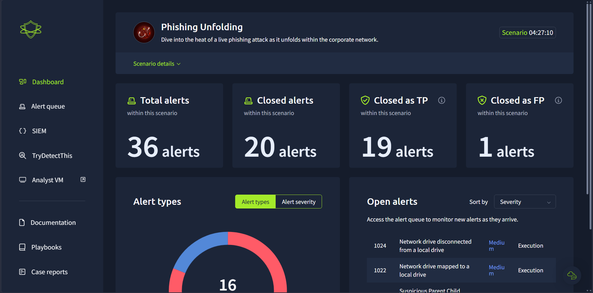
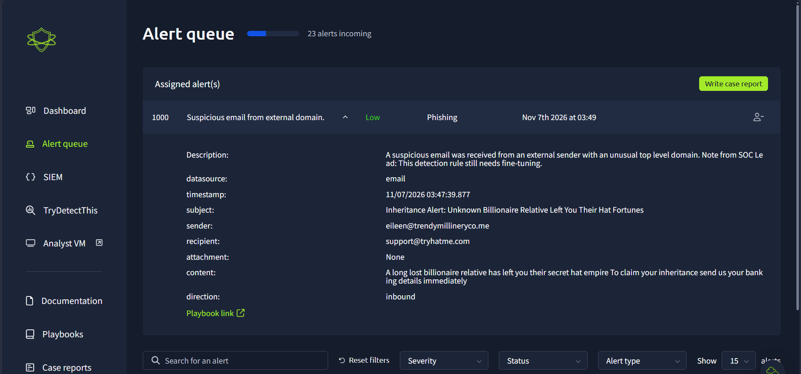
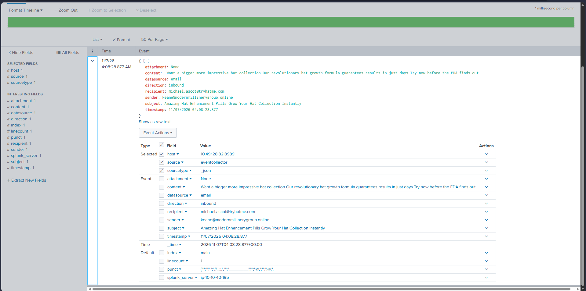
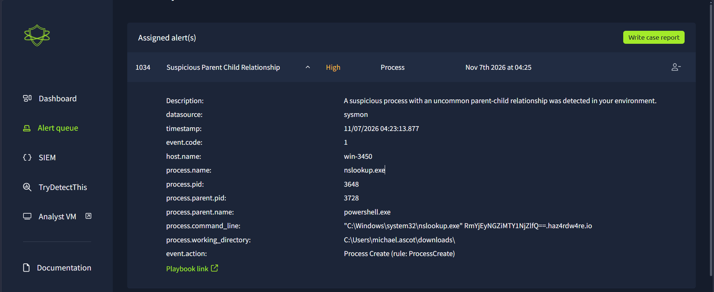
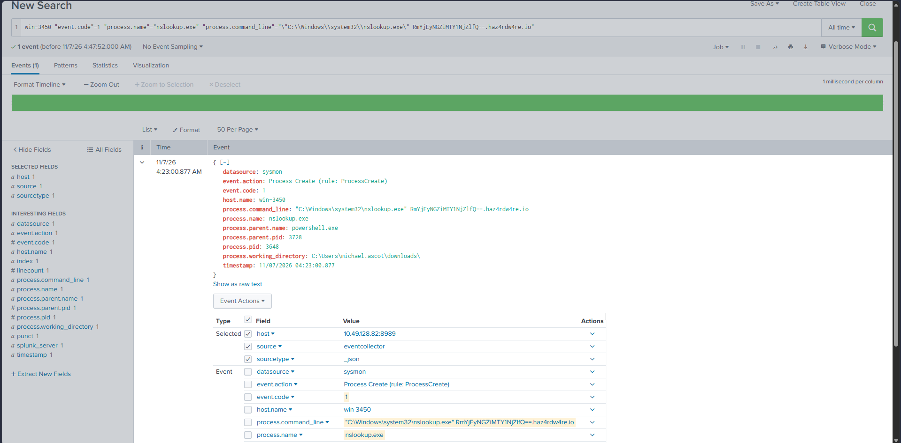
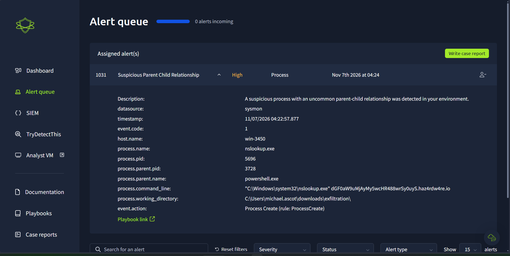
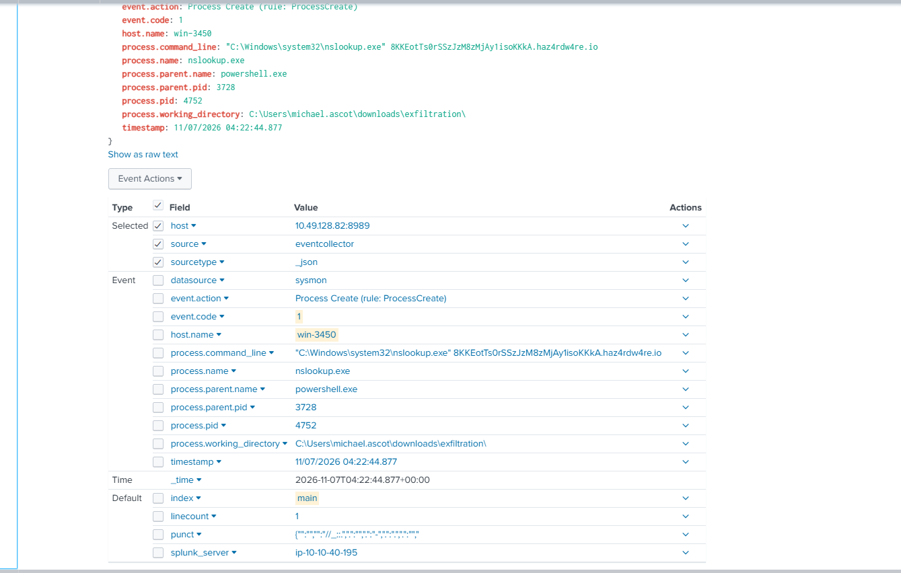
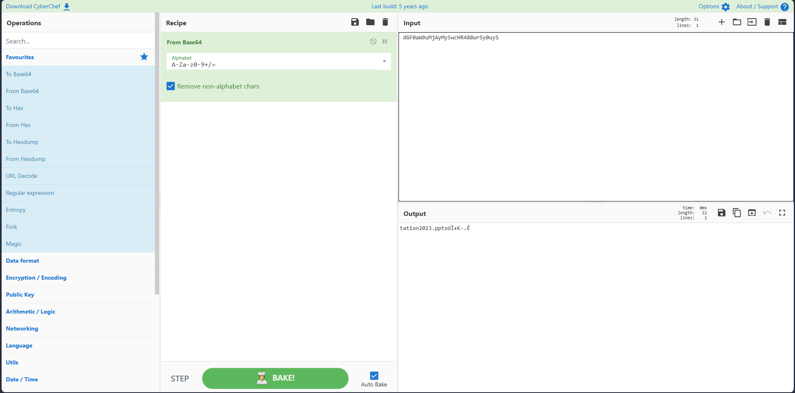
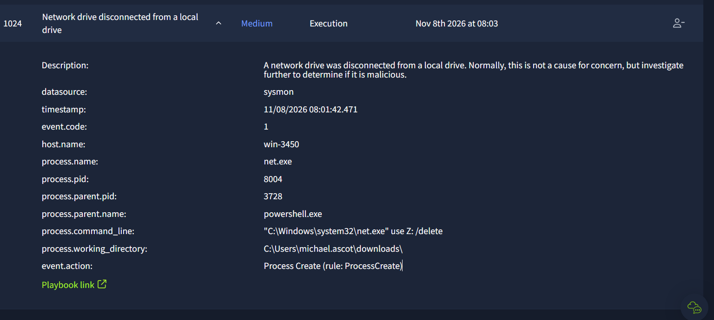

# Case 03: Phishing Unfolding – Phishing-to-DNS-Exfiltration on `win-3450`

- **Environment:** TryHackMe SOC Simulator – *Phishing Unfolding* (Medium) | SIEM: Splunk 8.2.6 | Data sources: Sysmon, Email logs
- **Alert Volume:** 36 alerts total – mix of phishing/spam emails and Sysmon process alerts
- **Severity:** `High` | **Triage Verdict:** `True Positive` (one host compromised)
- **Escalation Decision:** `Escalated to Tier 2 / IR` – active data exfiltration from an internal host
- **MITRE ATT&CK:** `T1566.001` (Spearphishing Attachment)\*, `T1204.002` (User Execution: Malicious File)\*, `T1059.001` (PowerShell), `T1074.001` (Local Data Staging), `T1070` (Indicator Removal – network share removed), `T1132.001` (Standard Encoding – Base64), `T1071.004` (Application Layer Protocol: DNS), `T1048.003` (Exfiltration Over Unencrypted Non-C2 Protocol)

> [!NOTE]
> Techniques marked \* are based on the analyst's recollection of the scenario and were **not captured in screenshots**. All other findings are backed by the evidence below.

---

## 1. Executive Summary
Out of 36 alerts, most were phishing/spam emails that reached mailboxes but showed no follow-up activity on any host; one attack succeeded. On host `win-3450` (user `michael.ascot`), a `powershell.exe` process (PID `3728`) running from the user's `Downloads` folder repeatedly spawned `nslookup.exe` with Base64-encoded subdomains of `haz4rdw4re[.]io` from a staging folder `C:\Users\michael.ascot\downloads\exfiltration\`, which is DNS-based data exfiltration, not a C2 lookup. The same PowerShell process also removed a mapped network drive (`net use Z: /delete`), so the host should be isolated, `haz4rdw4re[.]io` blocked at DNS/egress, and the case escalated to Tier 2 to determine exactly which files left the network.

---

## 2. Alert Scope
| Item | Value |
| :--- | :--- |
| **Compromised Host** | `win-3450` |
| **Compromised User** | `michael.ascot` (`michael.ascot@tryhatme.com`) |
| **Malicious Parent Process** | `powershell.exe` – PID `3728` |
| **Child Processes Observed** | `nslookup.exe` (PIDs `3648`, `3800`, `4752`, `5696`), `net.exe` (PID `8004`) |
| **Exfiltration Domain** | `haz4rdw4re[.]io` |
| **Staging Directory** | `C:\Users\michael.ascot\downloads\exfiltration\` |
| **Network Drive Removed** | `Z:` |
| **Other Recipients Targeted (no host compromise observed)** | `support@`, `contact@`, `liam.espinoza@`, `yani.zubair@`, `michael.ascot@` (`tryhatme.com`) |

---

## 3. Investigation Timeline (Scenario Time, UTC)

| Timestamp | Source / Alert | Event |
| :--- | :--- | :--- |
| `2026-11-07 03:47:39` | Email – Alert 1000 | First of many inbound scam emails (`eileen@trendymillineryco[.]me` → `support@tryhatme.com`, "Inheritance Alert…"). No attachment and no host activity after it. **TP (phishing), no escalation.** |
| `2026-11-07 04:08:28` | Email (Splunk) | Spam email to `michael.ascot@tryhatme.com` from `keane@modernmillinerygroup[.]online`. No attachment. |
| *Not captured* | Email / Sysmon | *Analyst recollection:* phishing email to `michael.ascot` with a ZIP attachment, which was downloaded, extracted, and opened from `Downloads`, starting `powershell.exe` (PID 3728). |
| *Not captured* | Sysmon – Alert 1022 | "Network drive mapped to a local drive" – a network share was mapped as a local drive (listed on dashboard; details not captured). |
| `2026-11-07 04:22:44` | Sysmon EID 1 (Splunk) | `powershell.exe` (3728) → `nslookup.exe` (4752) `8KKEotTs0rSSzJzM8zMjAy1isoKKkA.haz4rdw4re[.]io`, working dir `...\downloads\exfiltration\`. |
| `2026-11-07 04:22:57` | Sysmon – Alert 1031 / 1028 | More `nslookup.exe` queries (PIDs 5696, 3800) with Base64 labels to `haz4rdw4re[.]io` from the `exfiltration` folder. |
| `2026-11-07 04:23:00` | Sysmon – Alert 1034 | `nslookup.exe` (3648) `RmYjEyNGZiMTY1NjZlfQ==.haz4rdw4re[.]io`, working dir `...\downloads\`. |
| `2026-11-08 08:01:42`† | Sysmon – Alert 1024 | `powershell.exe` (3728) → `net.exe use Z: /delete` – mapped network drive removed. |

† *Alert 1024 was captured in a second run of the scenario, so its absolute timestamp cannot be compared directly with the 2026-11-07 events. The same parent PID (`3728`) and host tie it to the same activity chain.*

---

## 4. Evidence

#### Evidence 1 – Scenario Overview
36 alerts total. Dashboard shown mid-investigation (20 closed: 19 TP / 1 FP).


#### Evidence 2 – Phishing Noise (Alert 1000)
Typical advance-fee scam email: external `.me` domain, urgent "send your banking details" content, shared mailbox recipient, no attachment.


#### Evidence 3 – Spam Email Reaching the Compromised User
Email log showing `michael.ascot` was also receiving spam from external domains (no attachment in this message).


#### Evidence 4 – Suspicious Parent-Child Relationship (Alert 1034)
`powershell.exe` launching `nslookup.exe` with a Base64 string as a subdomain of `haz4rdw4re.io`, run from the user's `Downloads` folder.


#### Evidence 5 – SIEM Pivot on the Same Event
```spl
win-3450 "event.code"=1 "process.name"="nslookup.exe"
```


#### Evidence 6 – Exfiltration Staging Folder (Alert 1031)
The working directory changes to `C:\Users\michael.ascot\downloads\exfiltration\`, which shows data was being staged before it was sent out.


#### Evidence 7 – Repeated DNS Queries from the Staging Folder


#### Evidence 8 – Decoding a DNS Label
Decoding the label `dGF0aW9uMjAyMy5wcHR4...` returns readable text `tation2023.pptx`. Each label is a **slice of one continuous Base64 stream**, so single labels only decode partially. This confirms that file data (including a `.pptx` filename) was being encoded into DNS queries.


#### Evidence 9 – Network Drive Removed (Alert 1024)
The same PowerShell parent (PID `3728`) runs `net use Z: /delete`, removing the mapped share after use.


---

## 5. What Could Make This Benign?
| Hypothesis | Test | Result |
| :--- | :--- | :--- |
| Normal DNS troubleshooting by IT | Would show a few manual lookups of real hostnames | ❌ Many automated lookups, each with a different Base64 label, all to one unknown domain |
| Admin script disconnecting drives | Admin scripts don't run from a user's `Downloads` folder | ❌ Same PowerShell PID 3728 that performed the DNS exfiltration |
| Phishing emails = compromise everywhere | Checked for host activity after each email | ❌ Only `win-3450` showed malicious process activity; the other emails were delivered with no follow-up activity |

**Conclusion:** Confirmed **True Positive** – data exfiltration over DNS from `win-3450`.

---

## 6. IOCs (Defanged)
- **Exfiltration Domain:** `haz4rdw4re[.]io`
- **Sample DNS Queries:**
  - `RmYjEyNGZiMTY1NjZlfQ==.haz4rdw4re[.]io`
  - `dGF0aW9uMjAyMy5wcHR488wrSy0uyS.haz4rdw4re[.]io`
  - `nLz8nMDy7NzU0sqtSryCmu4OVyprsk.haz4rdw4re[.]io`
  - `8KKEotTs0rSSzJzM8zMjAy1isoKKkA.haz4rdw4re[.]io`
- **Host / User:** `win-3450` / `michael.ascot`
- **Process Chain:** `powershell.exe (3728)` → `nslookup.exe` / `net.exe`
- **Staging Path:** `C:\Users\michael.ascot\downloads\exfiltration\`
- **Phishing Sender Domains Observed:** `trendymillineryco[.]me`, `modernmillinerygroup[.]online`, `hatventuresworldwide[.]online`

---

## 7. Containment & Remediation
1. **Host:** Isolate `win-3450`; kill `powershell.exe` PID 3728 and its children; collect a forensic image (memory + disk) before cleanup.
2. **Network:** Block/sinkhole `haz4rdw4re[.]io`; review DNS logs for **any other host** querying it; alert on long/high-entropy subdomains.
3. **Identity:** Reset `michael.ascot` credentials and revoke active sessions.
4. **Data:** Identify the share that was mapped to `Z:` (Alert 1022) and the files copied into `...\exfiltration\` so the business can assess data loss.
5. **Email:** Purge the phishing emails from all mailboxes and block the sender domains. Note that blocking senders alone does **not** fix the compromised host.
6. **Escalation:** Hand off to Tier 2 / IR, since data loss is confirmed.

---

## 8. Detection Opportunities
- `powershell.exe` spawning `nslookup.exe` (rare parent-child relationship).
- `nslookup.exe` with an argument longer than 25 characters or containing Base64 characters (`=`, mixed case).
- Process working directory containing `\Downloads\` for scripting engines.
- `net.exe use <drive> /delete` with a non-explorer parent.
